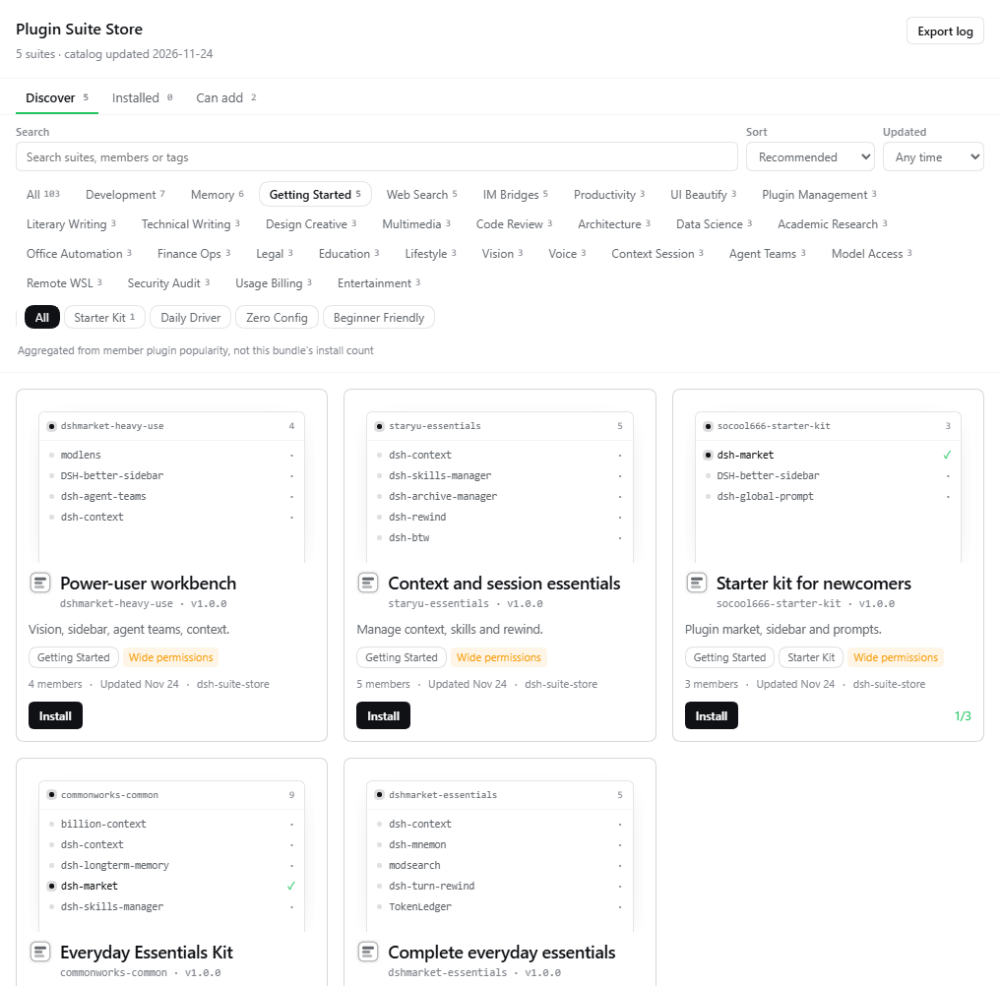

<p align="center">
  
</p>

# dsh-suite-store

English | [中文](README.zh.md)

[](https://www.npmjs.com/package/dsh-suite-store)

> DeepSeek Harness Plugin Suite Store · Plugin Suite Store

## Why this plugin exists

> Problem: the dsh plugin community is growing rapidly, with a wide variety of individual plugins of uneven quality.

Except for industry practitioners, most dsh users are encountering Agent / Harness concepts for the first time. After installing dsh, they often do not know where to start, nor which plugins suit them. At the same time, some bundle authors want to share their plugin combinations but lack a common platform.

We hope to solve these problems through the strength of the community.

## How it solves them

> This plugin organizes and collects community plugin suites across different fields and specialties, and has set up categories such as `Getting Started` to provide the best plugin combinations for people with different needs.

The suite catalog is mainly maintained by the community; see [`dsh-suite-store-catalog`](https://github.com/dsh-suite-store/dsh-suite-store-catalog).


Installing plugins is usually a do-it-yourself affair: search, compare, install one by one, and then confirm they work well together. This plugin moves the "combination" step up front — what gets listed is not an individual plugin, but a **suite** assembled for a specific scenario.

It is a plugin for DeepSeek Harness. Once installed into a profile, a "**Plugin Suite Store**" entry appears in the sidebar, where the catalog, search, category filters, and install dialog all live on one page.



## The two repositories

The store plugin and the suite catalog are separate:

| Repository | Contents | Maintained by |
|---|---|---|
| [`dsh-suite-store/dsh-suite-store`](https://github.com/dsh-suite-store/dsh-suite-store) (this repo) | The plugin itself: UI + install core | Maintainers |
| [`dsh-suite-store/dsh-suite-store-catalog`](https://github.com/dsh-suite-store/dsh-suite-store-catalog) (data repo) | Suite submissions | **Anyone, via PR** |

## Installation

- **Official DSH Desktop**: in the app, go to **Settings → Plugins** and enter `dsh-suite-store` to install.
- **`dsh web`**:

  ```sh
  dsh plugin --profile web add dsh-suite-store
  ```

- **GitHub source**: `add github:dsh-suite-store/dsh-suite-store`. Note: pnpm will ask whether to allow build scripts. To skip that step, use the prebuilt package attached to a release:

  ```sh
  dsh plugin --profile <profile> add https://github.com/dsh-suite-store/dsh-suite-store/releases/download/v<version>/dsh-suite-store-<version>.tgz
  ```

## Security

- **Plugins have a provenance.** The store only recognizes suites reviewed in the data repo; plugin members all come from the curated plugin list, and plugins not in that list will not be added.
- **Build scripts are off by default.** Under pnpm ≥10, you must explicitly confirm to allow builds.
- **Permissions are shown.** Member plugins are third-party code, and all permission details are listed in full.

## Submit your suite

**This repository is the plugin, not the catalog.**

To share a suite, go to [**dsh-suite-store-catalog**](https://github.com/dsh-suite-store/dsh-suite-store-catalog) to submit it.

## Development

```bash

pnpm install
pnpm run check        # typecheck (three projects) + vitest + build
pnpm run build        # produces lib/ and client/client.js
npm pack              # dsh-suite-store-1.0.3.tgz
```

## Feedback

- For bugs, open [issues](https://github.com/dsh-suite-store/dsh-suite-store/issues). Describing "which host, which package, and where it got stuck" is more useful than a screenshot; including the exported log makes diagnosis faster.
- For suite submissions and catalog data fixes, go to the [catalog](https://github.com/dsh-suite-store/dsh-suite-store-catalog).
- Feature suggestions via issues are fine too.
- PRs are welcome.

## License

MIT
