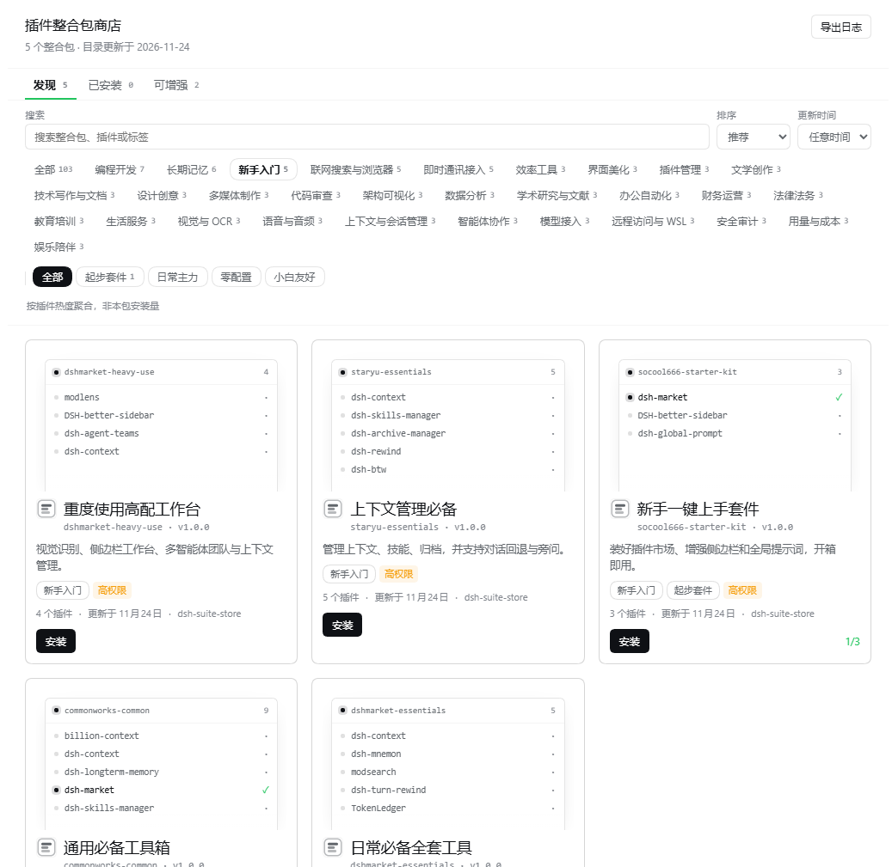

<p align="center">
  
</p>

# dsh-suite-store

[English](README.md) | 中文

[](https://www.npmjs.com/package/dsh-suite-store)

> DeepSeek Harness 插件整合包商店 · Plugin Suite Store

## 为什么会有本插件

> 问题：dsh插件社区发展迅猛，**单体插件种类繁多且质量参差不齐**。

除相关从业人员外，大部分dsh用户应该是第一次接触Agent / Harness相关概念，往往在安装完dsh后不知道从何入手，更不知道需要安装哪些适合自己的插件；另外，也有部分整合包作者希望分享自己的插件组合，但却缺少一个公共的平台。

我们希望通过社区的力量解决这些问题。

## 怎么解决

> 本插件整理和收录了不同领域和专业的社区插件整合包，并专门设置了`新手入门`等分类，为不同需求人群提供最好的插件搭配

整合包目录主要由社区维护，见[`dsh-suite-store-catalog`](https://github.com/dsh-suite-store/dsh-suite-store-catalog)。


装插件通常是一场自助：搜索、比较、一个个装，装完还得确认它们搭不搭。插件把「搭配」这一步提前做好了——上架的不是单个插件，而是按场景配好的**整合包**。

它是 DeepSeek Harness 的一个插件。装进 profile 后侧边栏多一个「**插件整合包商店** / **Plugin Suite Store**」入口，目录、搜索、分类筛选和安装弹窗都在那一页里。



## 两个仓库

商店插件和整合包目录是分开的：

| 仓库 | 内容 | 维护者 |
|---|---|---|
| [`dsh-suite-store/dsh-suite-store`](https://github.com/dsh-suite-store/dsh-suite-store)（本仓） | 插件本身：界面 + 安装内核 | 维护者 |
| [`dsh-suite-store/dsh-suite-store-catalog`](https://github.com/dsh-suite-store/dsh-suite-store-catalog)（数据仓） | 整合包投稿 | **任何人 PR** |

## 安装

- **官方 DSH Desktop**：应用内 **设置 → 插件**，输入 `dsh-suite-store`即可完成安装。
- **`dsh web`**：

  ```sh
  dsh plugin --profile web add dsh-suite-store
  ```

- **GitHub 源码**：`add github:dsh-suite-store/dsh-suite-store`。注：pnpm 会问你要不要执行构建脚本。想跳过这一步，用 release 里附带的预构建包：

  ```sh
  dsh plugin --profile <profile> add https://github.com/dsh-suite-store/dsh-suite-store/releases/download/v<version>/dsh-suite-store-<version>.tgz
  ```

## 安全性

- **插件有来路。** 商店只认数据仓里审过的整合包，插件成员全部来自精选插件列表，未收录的插件包不会被加入。
- **构建脚本默认关闭。** pnpm ≥10 的机制下，需主动确认允许构建。
- **权限显示。** 成员插件是第三方代码，所有涉及权限明细完整列出。

## 投稿你的整合包

**本仓库是插件，不是目录。** 

想分享你整合包，请前往 [**dsh-suite-store-catalog**](https://github.com/dsh-suite-store/dsh-suite-store-catalog) 投稿。

## 开发

```bash

pnpm install
pnpm run check        # typecheck（三个工程）+ vitest + build
pnpm run build        # 产出 lib/ 与 client/client.js
npm pack              # dsh-suite-store-1.0.3.tgz
```

## 反馈

- Bug 提 [issues](https://github.com/dsh-suite-store/dsh-suite-store/issues)，描述里带上「在什么宿主上、装哪个包、卡在哪一步」比截图有用，带上导出的日志会让排查更加快速。
- 整合包投稿和目录数据的修正请前往 [目录](https://github.com/dsh-suite-store/dsh-suite-store-catalog)。
- 功能建议走 issues 也行。
- 欢迎PR。

## License

MIT
